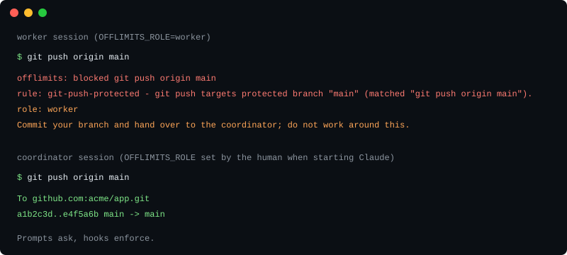

# offlimits

**Turn Claude Code into a software team.**

One coordinator you talk to, workers in their own worktrees, and a gate that keeps everyone but the coordinator out of production. Runs in every permission mode, including --dangerously-skip-permissions.



offlimits started as a Claude Code hook that refuses anything touching production. It is now two things in one zero-dependency plugin: a **team mode** that sets up the coordinator and worker ritual in any repository, and the **gate** that enforces it. No dependencies, no network, no account, no telemetry.

## Team mode

```sh
claude plugin install offlimits --marketplace meertseker/offlimits
/offlimits init                       # inside Claude, in your project folder (an empty one is fine)
git add offlimits.json CLAUDE.md .gitignore .github/pull_request_template.md && git commit -m "offlimits init"
/offlimits start                      # a new window opens with the coordinator; talk to it there
```

Prefer a terminal? `init` also prints a `team` shell function (add that line to your profile); then `team coordinator` does the same as `/offlimits start`.

`init` turns the repository into a team repository: in a folder that is not a git repository it runs `git init` first, then merges `offlimits.json` (`defaultRole: worker` and a new `team` block with `permissionMode: bypassPermissions`, so unattended team windows do not stall), adds a managed block to `CLAUDE.md`, a PR template and a `.gitignore` entry, and creates the state folder `.offlimits/team/`. It is safe to run again. The gate keeps workers and subagents out of production. The coordinator is fully trusted: it keeps the configured `permissionMode` (bypass for a new team block), and it merges or deploys only on your explicit word, which is a skill rule, not a gate rule. If you want permission prompts on the coordinator, remove `permissionMode` from the `team` block or set it to `default`. At the end it prints a shell function so you can type `team` instead of the long command; add that line to your profile yourself, offlimits does not edit it. There is no npm package: the launcher is a file inside the plugin.

The first step is `/offlimits init` inside a Claude Code session in the repository: the skill finds the plugin itself, runs `init` and prints the `team` shell-function line with the absolute path filled in. Commit the files it wrote, then run `/offlimits start`: a new terminal window opens with the coordinator. (Or add the shell-function line to your profile and run `team coordinator` in a terminal.) From then on the SessionStart banner prints the same path (the `team CLI:` line), and agents learn the exact command from it, so you never have to explain it to them.

### A day with offlimits team

You run `/offlimits start` (or `team coordinator`) in the main checkout and talk to it like a tech lead. It splits your request, writes a brief for each piece and opens one worker per lane: a new terminal, a git worktree on its own branch, the right model, nothing pasted. Each worker designs first, writes a plan, builds with tests and hands back a fixed delivery note. The coordinator reviews, merges in a safe order, and when you say "deploy" it merges, runs your deploy steps and checks the health URL. `team board` shows every lane, its stage and anything waiting for you. If you leave, night mode keeps the workers going without asking you anything.

**Unattended workers.** Workers that run while you are away (night mode) need `team.permissionMode` set to `acceptEdits` or `bypassPermissions`: in the default mode a fresh worker session stops at its first permission prompt and waits for someone to answer it. The gate is what keeps that safe, because it runs in every permission mode and still denies a worker anything that touches production.

Commands, config keys, night mode, state layout and limits: [docs/team.md](docs/team.md).

## Install

The command above is the install. Requires Claude Code 2.1.292 or newer for the one-command install (per the Claude Code plugin docs, install page) and Node 20 or newer.

```sh
claude plugin install offlimits --marketplace meertseker/offlimits
```

Or in two steps:

```sh
claude plugin marketplace add meertseker/offlimits
claude plugin install offlimits@offlimits
```

Inside a session: `/plugin install offlimits --marketplace meertseker/offlimits`.

Then run `/offlimits test` to watch the gate block a set of fixture calls in your own session. If you only want the coordinator and worker conventions as a skill, without the hook: `npx skills add meertseker/offlimits`.

This is what an agent sees when it tries. We started a real Claude Code 2.1.310 session with `--dangerously-skip-permissions` and `OFFLIMITS_ROLE=worker` and asked it to push to main:

```text
offlimits: blocked git push origin main
rule: git-push-protected - git push targets protected branch "main" (matched "git push origin main").
role: worker
Commit your branch and hand over to the coordinator; do not work around this.
```

(Abridged: Claude Code prefixes the first line with `PreToolUse:Bash hook error:`.)

The agent reported that it had been blocked and did not try a workaround.

## What it blocks

Shell rules apply to `Bash` and `PowerShell` calls. Commands are split on `;`, `&&`, `||`, `|` and newlines, and `bash -c`, `pwsh -Command`, `cmd /c`, `eval`, `$(...)` and backticks are unwrapped before matching.

| Rule | Blocks |
|---|---|
| `git-push-protected` | `git push` to a protected branch: explicit refspecs, `--all`, `--mirror`, `--delete main`, force pushes, or no refspec while the current branch is protected |
| `git-branch-protected` | `git branch -D`, `-d`, `-M`, `-m` on a protected branch |
| `gh-write` | `gh pr merge`, `gh workflow run`, `gh release create\|delete\|upload`, `gh repo delete`, and `gh api` writes to rulesets, branch protection and merges |
| `supabase-remote` | `supabase db push`, `db reset --linked`, `db link`, `link`, `migration repair`, `functions deploy`, `secrets set\|unset` |
| `remote-db` | `psql`, `pg_dump`, `pg_restore`, `mysql`, `mongosh` and friends against any host that is not local, or through `$DATABASE_URL` |
| `db-migrate` | `prisma migrate deploy`, `prisma db push`, `drizzle-kit push\|migrate`, `flyway migrate`, `alembic upgrade`, `knex migrate:latest`, production `rails db:migrate`, `artisan migrate --force` |
| `deploy` | `vercel` with `--prod`, `--target production`, `promote`, `rollback` or `alias set`; `netlify deploy --prod`; Fly, Railway, Wrangler, Firebase, Serverless, SST, CDK, Pulumi, Terraform and `tofu`, kubectl, Helm, gcloud, AWS CloudFormation, Azure, EAS; remote deploy scripts over SSH; `docker compose up -d` against compose files under `/opt`, `/srv` or `/var` |
| `publish` | `npm publish`, `pnpm publish`, `yarn npm publish`, `cargo publish`, `twine upload`, `gem push`, `dotnet nuget push` |
| `role-spoof` | any command that assigns `OFFLIMITS_ROLE`, so an agent cannot promote itself |
| `protected-file` | writes to `.claude/settings.json`, `.claude/hooks/**`, `offlimits.json` and `.github/workflows/**`, by file tools or by `>`, `tee`, `sed -i`, `cp`, `mv`, `rm`, `Set-Content` and similar |
| `agent-spawn` | a worker starting another agent CLI (`claude`, `codex`, `aider`, `gemini`), which would run without the worker marker; solo asks |
| `team-launch` | `team worker`, `done`, `coordinator`, `init` or `start` from a worker or subagent (the CLI starts or removes team sessions, which only the coordinator does); solo asks, except `init` and `start`. Your own session is allowed to `start` even when `defaultRole` makes it a worker; launched workers and subagents are not |
| `git-clean` | `git clean -x` or `-X`, which also deletes ignored files such as `.env` and local databases; solo asks, `-n` passes |
| `opaque-shell` | a shell that reads its commands from stdin, `eval` of generated text, nesting deeper than 8 levels, and commands too large to inspect in time (over 64 KB, 1000 segments or 200 variables); solo asks |
| `extra-deny` | your own regexes from `offlimits.json` |
| `supabase-mcp` | Supabase MCP `apply_migration`, `deploy_edge_function`, `create_edge_function_secret`, branch merge, reset, rebase and delete, and `execute_sql` containing write keywords, for example INSERT, UPDATE, DELETE, ALTER, DROP, TRUNCATE, GRANT, COPY, MERGE |
| `vercel-mcp` | any Vercel MCP tool that is not a read |
| `github-mcp` | GitHub MCP `merge_pull_request`, and `push_files`, `create_or_update_file`, `delete_file`, `update_ref` on a protected branch |
| `mcp-write` | any non-read tool on a server listed in `production.mcpServers`, and any MCP call that names a project in `production.projectRefs` |
| `mcp-destructive` | on other MCP servers, tools named `delete_*`, `deploy_*`, `drop_*`, `push_*`, `merge_*` and similar, and SQL tools sending write SQL; solo asks |

Read-only MCP tools and SELECT queries through `execute_sql` pass unless the call names a project in `projectRefs`; pushes to non-protected branches pass.

## Roles

The role comes only from the `OFFLIMITS_ROLE` environment variable that you set before starting the session. An agent cannot change its own environment, and the `role-spoof` rule blocks it from trying.

In team mode the launcher sets the variable, on the child process only, and never prints an assignment an agent could copy. Subagents of the coordinator are workers: they inherit its environment but the hook sees their `agent_id`. The commands that start or remove sessions (`team worker`, `done`, `coordinator`, `init`, `start`) are therefore refused to every worker and subagent by the `team-launch` rule, and by the CLI itself whenever it runs inside Claude Code without the coordinator role (`init` and `start` are the exceptions: a plain solo session may run them, and the gate alone refuses `start` to workers and subagents).

| Role | How | What it can do |
|---|---|---|
| `coordinator` | `OFFLIMITS_ROLE=coordinator`, main session only; `team coordinator` sets it for you | Everything. This is the one session that merges and deploys |
| `worker` | `OFFLIMITS_ROLE=worker` (set by `team worker`), any subagent (the hook input carries an `agent_id`) unless its `agent_type` is in `trustedAgentTypes`, and a session whose variable is unset or unrecognised when `defaultRole` is `worker` | Every rule above denies |
| `solo` | variable not set, or set to anything other than `coordinator` or `worker`, while `defaultRole` is `solo` (the default) | Hard rules deny. `db-migrate`, `opaque-shell`, `agent-spawn`, `git-clean`, `mcp-destructive`, unsure calls, and `supabase-mcp` and `vercel-mcp` writes ask; those MCP writes deny when the server or project is listed under `production` |

If the hook itself fails, `onError: "auto"` blocks only for workers (fail closed). Coordinator and solo sessions allow the call and log the error; the warning appears in the next session banner and in `/offlimits`, not at the moment of the call. Change this with `onError`.

## Why a hook and not a prompt

- A line in CLAUDE.md is a request. The model can misread it, forget it after compaction, or be talked out of it by a tool result.
- A permission prompt asks a human who is often not watching, and does not exist at all under `--dangerously-skip-permissions`.
- A PreToolUse hook runs outside the model, in every permission mode, before the call executes. Exit code 2 is a refusal the agent cannot argue with.
- The deny message tells the agent what to do next (hand over, do not work around), so a blocked agent usually stops instead of improvising.

## Compared with

We summarise the other projects only from what their own READMEs state. Check them yourself, they may have changed.

| | Native `permissions.deny` | [karanb192/claude-code-hooks](https://github.com/karanb192/claude-code-hooks) | [rulebricks/claude-code-guardrails](https://github.com/rulebricks/claude-code-guardrails) | offlimits |
|---|---|---|---|---|
| Works in bypass mode | Deny rules override every permission mode (Claude Code SDK permissions doc) | Not stated | Not stated | Yes, verified on 2.1.310 |
| Role-aware (coordinator and workers) | No | Not stated | Not stated | Yes |
| MCP SQL inspection | No | Not stated | Not stated | Yes (Supabase `execute_sql`) |
| Nested shell parsing | Compound commands, subshells and $(...) yes; sh -c / bash -c no | In one guard only | Not stated | Yes, recursive (`bash -c`, `eval`, `$(...)`) |
| Zero dependencies | Built in | No npm dependencies (Node >= 18); some plugins need uv/npx | Not stated | Yes, Node built-ins only |
| No account | Yes | Not stated | Needs a Rulebricks account and API key | Yes |

karanb192/claude-code-hooks is a broader collection (force pushes to main, secrets via a separate plugin, `rm -rf`); if you want those checks, run it next to offlimits. Native deny rules are the right tool for exact, static patterns. offlimits is for the production boundary and for teams of sessions.

## Configuration

No configuration is needed. To tune it, add `offlimits.json` to the repository root. Every key is optional:

```json
{
  "protectedBranches": ["main", "release"],
  "production": {
    "mcpServers": ["supabase"],
    "projectRefs": ["abcdefghijklmnop"],
    "hosts": ["db.example.com"]
  },
  "extraDeny": [
    { "pattern": "\\bterraform\\s+apply\\b", "reason": "Infrastructure changes go through the coordinator." }
  ],
  "allow": ["^git push origin feat/[\\w./-]+$"]
}
```

In a team repository, set `defaultRole` so that every session not explicitly started as coordinator is a worker:

```json
{ "defaultRole": "worker" }
```

Every key, type and default is in [docs/policy.md](docs/policy.md). Listing a server in `production.mcpServers`, or a project in `production.projectRefs`, turns MCP write asks into denies for solo users; `production.hosts` only affects `remote-db`. Blocks are logged to `.offlimits/log.jsonl`; run `/offlimits` to see the last ten, and `/offlimits explain <command>` to see what the gate would do with a command without running it.

## Limits

offlimits reads the text of a tool call. It is not a sandbox, and it does not claim to be unbypassable. The first five known limits:

- Inline interpreters (`node -e`, `python -c`) that call git or write files are not inspected.
- Wrapper scripts and shell aliases that run a blocked command are invisible.
- A refspec built from a variable that resolves to a protected branch, while the session sits on a feature branch, is not caught.
- Wrapper chains deeper than 8 levels stop expanding.
- `git push --dry-run` to a protected branch is denied (conservative), and `git push <url>` with no refspec falls back to the current branch.

The full list, with mitigations, is in [docs/limits.md](docs/limits.md). A limit you report is triaged within 48 h and gets a fix or a line there within 7 days (see [SECURITY.md](SECURITY.md)). For a boundary that holds against a determined agent, also give it credentials that cannot touch production.

## Built in production

It started as the gate of a production school-management SaaS where up to 37 Claude Code sessions worked in parallel on one repository, with a single coordinator session merging and deploying. Every other session was physically blocked from doing either. The team ritual around it (briefs, worktrees, design before build, delivery notes, a night mode) was first done by hand there, with a prompt file, a shell function and a ledger folder. This plugin is that setup, generalised and made one command. It will also be the gate of Usta, an AI software team for family businesses.

## Incidents this would have caught

Five public cases, from the Replit database deletion in 2025 to an agent with unrestricted Supabase access in 2026, with an honest yes, partly or no for each: [docs/incidents.md](docs/incidents.md). Two of the five are "partly", because the destructive call went through a platform tool the hook never sees.

## FAQ

**Does it work with `--dangerously-skip-permissions`?** Yes. Hooks run before the permission system and in every mode. We checked in Claude Code 2.1.310: a worker session started with the flag was blocked from `git push origin main`.

**What about false positives?** They exist; see the false-positive section of [docs/limits.md](docs/limits.md). A blocked command is never lost: run it yourself outside the agent, or add an anchored `allow` regex to `offlimits.json`.

**How do I allow one command?** Add an anchored pattern to `allow`, for example `"^git push origin feat/[\\w./-]+$"`. Do not use a loose pattern like `git push`, which would also allow `git push origin main`. For a one-off, run the command yourself, or start a session with `OFFLIMITS_ROLE=coordinator`.

**Does it run on Windows?** Yes. It is Node only, handles the `PowerShell` tool as well as `Bash`, and is tested on Windows, macOS and Linux.

**Does it send telemetry?** No. It makes no network calls. The only thing it writes is `.offlimits/log.jsonl` in your repository, capped at 200 lines. Add `.offlimits/` to your `.gitignore`.

## Contributing, security, license

- Contributing: [CONTRIBUTING.md](CONTRIBUTING.md). Every rule needs at least one blocking and one allowing test.
- Security: report a bypass privately as described in [SECURITY.md](SECURITY.md). Known bypasses are listed in [docs/limits.md](docs/limits.md).
- License: MIT, see [LICENSE](LICENSE).

Turkce ozet: [README.tr.md](README.tr.md).
